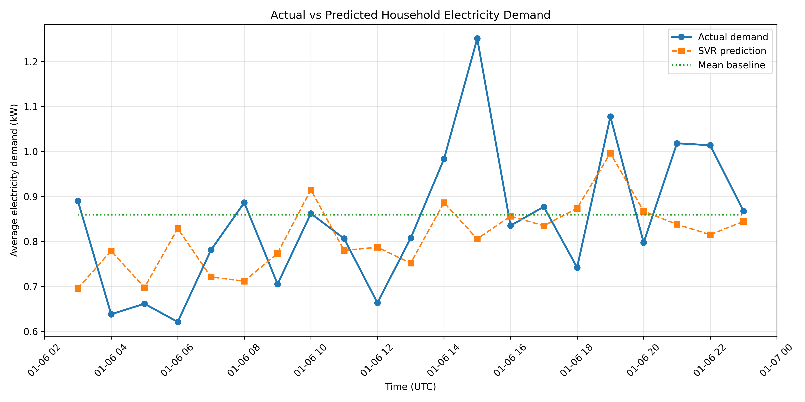

# Smart-Home-Electricity-Demand-

# Weather-Based Household Electricity Demand Forecasting Using SVR

## Project Overview

This project investigates the effectiveness of Support Vector Regression (SVR) for forecasting household electricity demand using historical weather conditions and time-related features.

Electricity consumption can fluctuate throughout the day due to household activities, environmental conditions, and energy usage patterns. Accurately forecasting electricity demand may help improve energy management and resource planning.

The primary objective of this project is to evaluate whether an SVR model can predict a household's average electricity demand one hour ahead and determine whether it provides meaningful improvements over a simple baseline.

A Streamlit dashboard was developed to demonstrate the model's predictions and compare them with actual historical electricity consumption.

## Research Question

**How effectively can Support Vector Regression predict one-hour-ahead household electricity demand using weather and time-related features?**

The project evaluates SVR using Mean Absolute Error (MAE), Root Mean Squared Error (RMSE), and the coefficient of determination (R²).

## Dataset

**Dataset:** Smart Home Dataset with Weather Information

**Source:** [Kaggle](https://www.kaggle.com/datasets/taranvee/smart-home-dataset-with-weather-information)

The original dataset contains approximately 503,911 observations and 32 columns, including household electricity consumption and weather measurements.

The available observations span approximately six days in January 2016.

### Selected Features

The following six features are used as model inputs:

| Feature | Description |
|---------|-------------|
| temperature | Average hourly outdoor temperature |
| humidity | Average hourly relative humidity |
| windSpeed | Average hourly wind speed |
| pressure | Average hourly atmospheric pressure |
| hour | Hour of the day (0–23) |
| day_of_week | Day of the week (0–6) |

### Target Variable

`target_next_hour_kw`

The target represents the household's average electricity demand during the hour following the observed weather conditions.

The model uses weather and time-related information from the current hour to predict average demand during the next hour.

Current-hour electricity demand is intentionally excluded from the input features to evaluate a weather-and-time-only forecasting approach.

## Data Preprocessing

The original dataset contains measurements recorded at approximately one-second intervals.

The preprocessing pipeline performs the following operations:

1. Loads the required electricity and weather columns.
2. Converts timestamps into UTC datetime values.
3. Removes invalid timestamps and missing target values.
4. Aggregates observations into hourly averages.
5. Retains hours containing at least 3,500 measurements.
6. Creates hour-of-day and day-of-week features.
7. Shifts electricity demand forward by one hour to construct the prediction target.
8. Removes observations without a valid consecutive next-hour target.

After preprocessing, the dataset contains **139 hourly observations**.

The processed dataset is saved as:

`data/processed_hourly.csv`

## Machine Learning Methodology

### Support Vector Regression

Support Vector Regression is a supervised machine learning algorithm that estimates a continuous target variable.

This project uses an SVR model with a Radial Basis Function (RBF) kernel to model potentially nonlinear relationships between weather conditions, time-related features, and household electricity demand.

### Feature Scaling

A `StandardScaler` is applied to the input features before training SVR.

Scaling is important because SVR is sensitive to differences in feature magnitude.

The scaler and SVR model are combined using a scikit-learn `Pipeline` to ensure consistent preprocessing during training and prediction.

### Chronological Data Splitting

The dataset is divided chronologically rather than randomly to preserve the temporal ordering of observations.

The initial experiment uses approximately:

- 70% training data
- 15% validation data
- 15% testing data

A boundary gap is used where necessary to reduce overlap between training targets and subsequent evaluation periods.

The resulting initial split contains:

| Dataset | Observations |
|---------|-------------:|
| Training | 96 |
| Validation | 20 |
| Testing | 21 |

The final model is refitted on the development portion before evaluation on the reserved test period.

### Baseline Model

SVR is compared against a training-mean baseline.

This baseline predicts the average target electricity demand observed in the training data.

The comparison helps determine whether SVR provides additional predictive value beyond a simple constant forecast.

### Hyperparameter Tuning

The initial SVR model uses default hyperparameters.

A small grid search evaluates combinations of:

- `C`: 0.1, 1, 10
- `epsilon`: 0.05, 0.1, 0.2

The best configuration is selected using validation MAE.

**Selected hyperparameters:**

- Kernel: RBF
- C: 0.1
- Epsilon: 0.05
- Gamma: scale

## Experimental Results

### Initial Validation Results

| Model | MAE (kW) | RMSE (kW) | R² |
|-------|---------:|----------:|---:|
| Training-mean baseline | 0.2654 | 0.3074 | -0.5940 |
| Default SVR | 0.7651 | 0.8548 | -11.3267 |

The default SVR model performed substantially worse than the baseline during initial validation.

Hyperparameter tuning improved the SVR validation MAE to **0.3180 kW**, although it remained higher than the baseline MAE.

### Final Test Results

| Model | MAE (kW) | RMSE (kW) | R² |
|-------|---------:|----------:|---:|
| Training-mean baseline | 0.1203 | 0.1549 | -0.0062 |
| Tuned SVR | 0.1157 | 0.1502 | 0.0538 |

The tuned SVR model achieved a slightly lower test MAE than the baseline.

However, the improvement was small, and the low R² indicates limited explanatory performance on the test period.

### Expanding-Window Cross-Validation

To investigate the consistency of SVR performance across different time periods, three chronological validation folds were evaluated.

| Fold | Baseline MAE (kW) | SVR MAE (kW) | SVR R² |
|------|------------------:|-------------:|-------:|
| 1 | 0.3268 | 0.2618 | -0.0097 |
| 2 | 0.7159 | 0.7493 | -0.8264 |
| 3 | 0.2603 | 0.3214 | -1.2189 |
| **Average** | **0.4343** | **0.4442** | **-0.6850** |

SVR outperformed the baseline in only one of the three folds.

These results indicate that the model's predictive performance varied across evaluation periods.

Because the SVR configuration was previously selected using an overlapping development period, this experiment is interpreted as a retrospective stability analysis rather than an independent nested cross-validation estimate.

## Prediction Visualization

The following graph compares actual electricity demand, SVR predictions, and baseline predictions during the held-out test period.



The visualization illustrates that SVR approximates some demand levels but struggles to capture larger fluctuations in electricity consumption.

## Streamlit Dashboard

An interactive Streamlit dashboard was developed to demonstrate the trained SVR model.

The dashboard allows users to:

- Select an observation from the historical test period.
- View its associated weather conditions.
- Generate an SVR prediction for the following hour.
- Compare predicted and actual electricity demand.
- Examine absolute prediction error.
- View overall test performance and prediction trends.

The dashboard uses the trained scikit-learn pipeline saved in `models/svr_model.joblib`.

It is intended for historical model evaluation rather than live forecasting.

## Project Structure

```text
Smart-Home-Electricity-Demand-/
|
|-- app.py
|-- README.md
|-- requirements.txt
|
|-- data/
|   |-- HomeC.csv
|   |-- processed_hourly.csv
|   |-- test_predictions.csv
|
|-- models/
|   |-- svr_model.joblib
|
|-- src/
|   |-- explore_data.py
|   |-- preprocess_data.py
|   |-- train_model.py
|   |-- visualize_results.py
|   |-- cross_validate.py
|
|-- documents/
    |-- svr_predictions.png
    |-- cross_validation_results.csv
```

Some generated files and the original dataset may be excluded from version control. See the dataset source and setup instructions below.

## Installation and Setup

### 1. Clone the Repository

```bash
git clone https://github.com/Monserrat970/Smart-Home-Electricity-Demand-.git
```

### 2. Create a Virtual Environment

```bash
python -m venv .venv
source .venv/bin/activate
```

On Windows, activate the environment using:

```powershell
.venv\Scripts\activate
```

### 3. Install Dependencies

```bash
python -m pip install -r requirements.txt
```

### 4. Download the Dataset

Download the Smart Home Dataset with Weather Information from Kaggle:

https://www.kaggle.com/datasets/taranvee/smart-home-dataset-with-weather-information

Place the dataset in the `data/` directory with the filename:

`HomeC.csv`

### 5. Explore and Preprocess the Data

```bash
python src/explore_data.py
python src/preprocess_data.py
```

### 6. Train the SVR Model

```bash
python src/train_model.py
```

This creates the trained model and saved test predictions.

### 7. Generate Visualizations and Cross-Validation Results

```bash
python src/visualize_results.py
python src/cross_validate.py
```

### 8. Launch the Streamlit Dashboard

```bash
python -m streamlit run app.py
```

Open the local URL displayed in the terminal, usually:

http://localhost:8501

## Project Limitations

Several limitations should be considered when interpreting the results.

**Limited data duration:** The dataset covers approximately six days in January 2016, preventing evaluation across different seasons and longer-term consumption patterns.

**Limited predictive features:** The model uses weather and time-related features without appliance activity, occupancy information, or previous electricity-demand values.

**Small evaluation periods:** The final test set contains only 21 hourly observations, limiting the reliability of performance estimates.

**Inconsistent cross-validation performance:** SVR did not consistently outperform the training-mean baseline across chronological validation folds.

**Historical demonstration:** The dashboard replays historical observations and does not retrieve live weather conditions or provide operational forecasts.

## Conclusion

This project evaluated Support Vector Regression for one-hour-ahead household electricity demand forecasting using weather and time-related features.

Although hyperparameter tuning substantially improved performance over the default SVR configuration, the model demonstrated only a marginal advantage over the baseline on the held-out test period.

Expanding-window cross-validation showed inconsistent performance, with SVR outperforming the baseline in only one of three folds.

These findings suggest that weather and time-related features alone may not provide sufficient information for reliable household electricity-demand forecasting using the available dataset.

Future improvements could include longer observation periods, historical electricity-demand features, additional baseline models, and more extensive time-series evaluation.

## Technologies Used

- Python
- pandas
- NumPy
- scikit-learn
- Support Vector Regression
- Matplotlib
- Streamlit
- joblib
